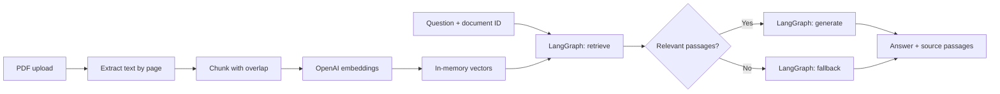

# Personal PDF Chatbot — FastAPI · LangGraph · RAG

A small backend that turns a readable PDF into a question-answering API. Upload a document, ask a question, and receive an answer alongside the passages retrieved from that document.

**Built and owned by kiarash.** This is a deliberately simplified portfolio project focused on backend engineering and the RAG workflow. It is independent of the AIhu production repository.

## What this project demonstrates

- **FastAPI:** typed request/response contracts, multipart uploads, dependency-based API-key authentication, clear HTTP errors and interactive API documentation.
- **RAG:** PDF extraction, overlapping chunks with page metadata, semantic embeddings, cosine similarity and document-scoped top-k retrieval.
- **LangGraph:** explicit state, retrieval and generation nodes, and a conditional fallback when no passages meet the similarity threshold.
- **Testing:** API workflow tests with a fake provider and OpenAI SDK adapter tests over mocked HTTP. Tests make no paid AI requests.

## Architecture


The image above is the original broader design. **This repository implements only the PDF ingestion and document-question-answering paths.** The relational database, separate owner/user roles, persistent vector database and multi-tenant authorization shown in the sketch are outside this simplified version.

The implemented workflow is:



An editable version of the implemented architecture is in [docs/architecture.drawio](docs/architecture.drawio).

### Read the code in this order

| File | Responsibility |
| --- | --- |
| [app/main.py](app/main.py) | FastAPI routes, authentication and HTTP error handling |
| [app/rag.py](app/rag.py) | PDF extraction, chunking, in-memory storage and semantic retrieval |
| [app/graph.py](app/graph.py) | LangGraph state, nodes and conditional edges |
| [app/providers.py](app/providers.py) | OpenAI embedding and answer calls behind a small testable interface |
| [app/schemas.py](app/schemas.py) | Validated API contracts |
| [app/config.py](app/config.py) | Environment-based configuration |


## Test without an OpenAI key

```bash
pytest -q
ruff check .
ruff format --check .
```

Tests generate synthetic PDFs, inject a deterministic provider and intercept SDK HTTP traffic. They cover ingestion → graph → deletion, missing/invalid keys, selected-document retrieval, no-context fallback, PDF limits, malformed embeddings and provider failures. They do not establish live OpenAI availability or real answer quality.

## Resume description

> Built a PDF question-answering backend with FastAPI and LangGraph, implementing text extraction, overlapping chunking, semantic retrieval, document-scoped API operations, source passages and automated API tests.

## Implementation references

- [FastAPI file uploads](https://fastapi.tiangolo.com/tutorial/request-files/)
- [LangGraph Graph API](https://docs.langchain.com/oss/python/langgraph/graph-api)
- [OpenAI embeddings](https://developers.openai.com/api/docs/guides/embeddings)
- [OpenAI text generation](https://developers.openai.com/api/docs/guides/text)
