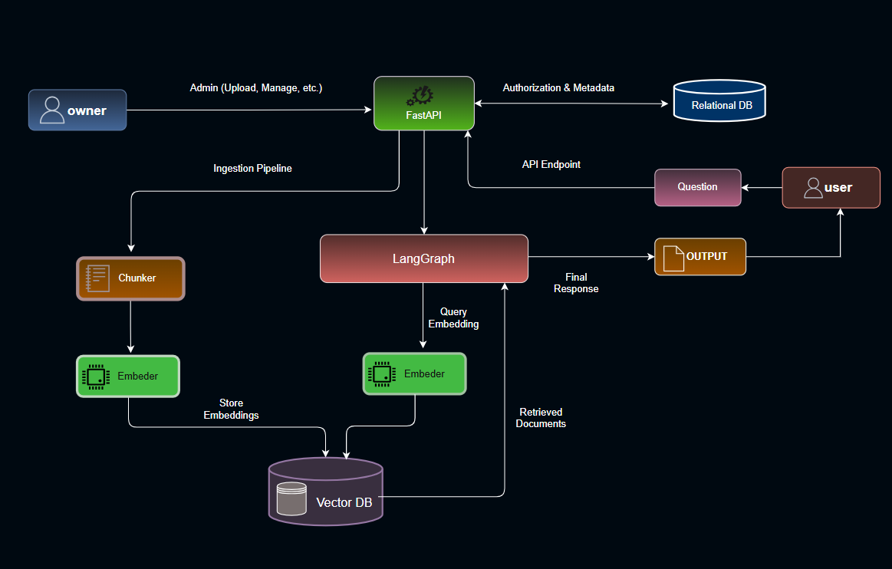
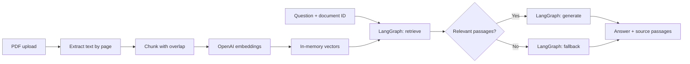

# Personal PDF Chatbot — FastAPI · LangGraph · RAG

A small backend that turns a readable PDF into a question-answering API. Upload a document, ask a question, and receive an answer alongside the passages retrieved from that document.

**Built and owned by kiarash.** This is a deliberately simplified portfolio project focused on backend engineering and the RAG workflow. It is independent of the AIhu production repository.

## What this project demonstrates

- **FastAPI:** typed request/response contracts, multipart uploads, dependency-based API-key authentication, clear HTTP errors and interactive API documentation.
- **RAG:** PDF extraction, overlapping chunks with page metadata, semantic embeddings, cosine similarity and document-scoped top-k retrieval.
- **LangGraph:** explicit state, retrieval and generation nodes, and a conditional fallback when no passages meet the similarity threshold.
- **Testing:** API workflow tests with a fake provider and OpenAI SDK adapter tests over mocked HTTP. Tests make no paid AI requests.

## Architecture



The image above is the original broader design. **This repository implements only the PDF ingestion and document-question-answering paths.** The relational database, separate owner/user roles, persistent vector database and multi-tenant authorization shown in the sketch are outside this simplified version.

The implemented workflow is:



An editable version of the implemented architecture is in [docs/architecture.drawio](docs/architecture.drawio).

### Read the code in this order

| File | Responsibility |
| --- | --- |
| [app/main.py](app/main.py) | FastAPI routes, authentication and HTTP error handling |
| [app/rag.py](app/rag.py) | PDF extraction, chunking, in-memory storage and semantic retrieval |
| [app/graph.py](app/graph.py) | LangGraph state, nodes and conditional edges |
| [app/providers.py](app/providers.py) | OpenAI embedding and answer calls behind a small testable interface |
| [app/schemas.py](app/schemas.py) | Validated API contracts |
| [app/config.py](app/config.py) | Environment-based configuration |

## Run locally

Requires **Python 3.11+**. The API is intended to run as one local process.

```bash
python -m venv .venv
# macOS/Linux:
source .venv/bin/activate
# Windows PowerShell instead:
# .\.venv\Scripts\Activate.ps1

python -m pip install -e ".[dev]"
```

Copy `.env.example` to `.env` (`cp .env.example .env`, or `Copy-Item .env.example .env` in PowerShell) and fill the two keys locally:

| Setting | Purpose / default |
| --- | --- |
| `APP_API_KEY` | Your own long, random access key for this API; required for all document/chat routes |
| `OPENAI_API_KEY` | Your OpenAI key; required for embeddings and answers |
| `EMBEDDING_MODEL` | `text-embedding-3-small` |
| `EMBEDDING_DIMENSIONS` | `256`; use a model that supports the `dimensions` parameter |
| `ANSWER_MODEL` | `gpt-4o-mini` |
| `TOP_K` | `4` passages |
| `MIN_SIMILARITY` | `0.25`; an example threshold, not an evaluated quality guarantee |

Never commit `.env` or real keys. Use only documents you are authorized to send to OpenAI. Real uploads call the embedding API; a question calls query embedding and, if evidence is found, answer generation. These calls can incur provider charges. SDK retries are disabled and each provider call has a 30-second timeout.

```bash
uvicorn app.main:app --reload --host 127.0.0.1 --port 8000
```

Open **http://127.0.0.1:8000/docs**, click **Authorize**, and enter `APP_API_KEY`. Upload a PDF, copy its `document_id`, and call `/chat` with that ID. `/health` reports application liveness only; it does not verify provider credentials or billing.

## API walkthrough

All document/chat routes require an `X-API-Key` header. These Bash examples assume `APP_API_KEY` is exported in your shell; use `curl.exe` or Swagger UI on Windows.

```bash
# 1. Upload a document you are allowed to process.
curl -X POST http://127.0.0.1:8000/documents \
  -H "X-API-Key: $APP_API_KEY" -F "file=@manual.pdf"

# 2. Replace DOCUMENT_UUID with the ID returned by the upload.
curl -X POST http://127.0.0.1:8000/chat \
  -H "X-API-Key: $APP_API_KEY" -H "Content-Type: application/json" \
  -d '{"document_id":"DOCUMENT_UUID","question":"How long is the warranty?"}'

# 3. Delete the document and its vectors from this process.
curl -X DELETE http://127.0.0.1:8000/documents/DOCUMENT_UUID \
  -H "X-API-Key: $APP_API_KEY"
```

Example response shape; the answer and scores below are illustrative:

```json
{
  "answer": "The warranty lasts two years. [1]",
  "status": "answered",
  "sources": [
    {
      "chunk_id": 1,
      "page": 1,
      "text": "The warranty lasts two years.",
      "similarity": 0.82
    }
  ]
}
```

| Method | Endpoint | Result |
| --- | --- | --- |
| GET | `/health` | Liveness; no authentication |
| POST | `/documents` | Extract, embed and store a PDF; returns `201` and its ID |
| GET | `/documents` | List document metadata |
| DELETE | `/documents/{document_id}` | Remove the document and vectors; returns `204` |
| POST | `/chat` | Run the graph for one document |

Invalid credentials return `401`; unknown documents `404`; capacity conflicts `409`; oversized files `413`; invalid input `422`; missing configuration or provider failures `503`. A failed ingestion does not create a partial document. If retrieval finds no eligible passages, the graph returns `status: "no_context"` with an empty source list and skips answer generation.

## Boundaries kept intentionally simple

- **Single workspace, one shared API key.** This is not tenant or browser-session isolation. Every holder of the key can access every stored document.
- **In-memory vectors.** No Pinecone, PostgreSQL, migrations or external storage setup. Restarting the process clears documents; multiple workers do not share state. Deletion removes application records and vectors, not historical data held by an external provider or an already-running request.
- **Readable PDFs only.** Up to 10,000,000 bytes, 20 pages and 60,000 extracted characters; no OCR or encrypted PDFs. At most 10 documents per process. Chunks use 1,000-character windows with 150-character overlap, separately within each page.
- **Evidence-aware prompting, not proof of correctness.** The model is instructed to use and cite retrieved passages. There is no independent grounding validator, citation checker or measured retrieval-quality benchmark. Document prompt injection remains a risk.
- **A learning and portfolio backend.** Public production hosting would additionally require appropriate rate/cost controls, hardened upload parsing, durable storage, per-user authorization and quality/security evaluation. Do not expose the local example directly as a public multi-user service.

## Test without an OpenAI key

```bash
pytest -q
ruff check .
ruff format --check .
```

Tests generate synthetic PDFs, inject a deterministic provider and intercept SDK HTTP traffic. They cover ingestion → graph → deletion, missing/invalid keys, selected-document retrieval, no-context fallback, PDF limits, malformed embeddings and provider failures. They do not establish live OpenAI availability or real answer quality.

## Resume description

> Built a PDF question-answering backend with FastAPI and LangGraph, implementing text extraction, overlapping chunking, semantic retrieval, document-scoped API operations, source passages and automated API tests.

## Implementation references

- [FastAPI file uploads](https://fastapi.tiangolo.com/tutorial/request-files/)
- [LangGraph Graph API](https://docs.langchain.com/oss/python/langgraph/graph-api)
- [OpenAI embeddings](https://developers.openai.com/api/docs/guides/embeddings)
- [OpenAI text generation](https://developers.openai.com/api/docs/guides/text)
